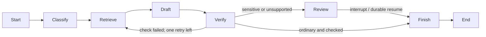

# CaseFlow

A LangGraph support-agent portfolio demo: retrieve policy evidence, draft a cited reply, check it, retry once, and pause for human review when needed. State survives a process restart through SQLite checkpoints. CLI and FastAPI interfaces use the same graph.

**Project status:** new, AI-assisted portfolio work created in November 2026. All policies, orders and evaluation cases are synthetic. This is not a previously deployed employer system. The default backend is deterministic extractive code, not an LLM; optional OpenAI mode generates structured replies through a real model.

## Run it

Python 3.10+:

```bash
python3 -m venv .venv
source .venv/bin/activate
python -m pip install -r requirements.lock
python -m pip install --no-deps -e .
caseflow run "When will my shipping delivery arrive?" --order-id DEMO-1001
```

No API key is needed for the offline path. Alternatively, `python -m pip install -e '.[dev,openai]'` resolves compatible current dependencies rather than the recorded lock.

Try a durable human review across separate processes:

```bash
caseflow run "Please refund my order" --thread refund-demo
caseflow show refund-demo
caseflow review refund-demo --approve --note "Checked the policy; release this informational reply."
caseflow show refund-demo
```

Approval releases a checked reply only. No payment, refund, email or account-change integration exists.

## Inspect the API

```bash
caseflow serve
# Open http://127.0.0.1:8000/docs for an interactive request/response interface.
```

Endpoints: `POST /tickets`, `GET /tickets/{thread_id}`, `POST /tickets/{thread_id}/review`, and `GET /health`. Supply `{"question":"Please refund my order"}` to start. A pending ticket returns `status: needs_review`; the review body is `{"approve":true,"note":"Reviewed the policy."}`. Completed/replayed reviews return HTTP 409. Invalid inputs return 422; missing tickets return 404.

This local demo has no authentication. Bind to loopback; do not expose its ticket/review endpoints publicly. The single-process lock serializes SQLite access. Multi-worker deployment needs proper authorization, transactional review claims and a production checkpointer.

## Optional real-model mode

```bash
export OPENAI_API_KEY='your-key'
export OPENAI_MODEL='your-structured-output-capable-model'
caseflow --backend openai run "How long does standard shipping take?"
```

Use your own model name; none is assumed or silently selected. This opt-in mode sends the question and retrieved synthetic context to OpenAI and may incur API charges. The adapter uses structured output, a request timeout and a bounded retry. The offline backend and mocked adapter contract are tested locally; live-provider quality/cost is not claimed without an actual provider run.

## Graph



The graph state includes intent/risk, retrieved policy ids, synthetic order context, draft/citations, validation failures, attempt count, review decision and per-node trace entries. A failed draft can trigger a broader retrieval query; attempts stop at two. Thread ids cannot overwrite previous runs, and completed decisions cannot be resumed again within the single-process service.

## Verify

```bash
pytest -q
ruff check .
python -m caseflow_agent.evaluate --out eval-results.local.json
```

See [design decisions](docs/design.md) and the [recorded offline evaluation](docs/evaluation.md). The evaluation measures known routing expectations and structural citation/number checks on a small synthetic suite. It is not a production answer-accuracy benchmark. Valid citations alone do not prove semantic grounding; the heuristic classifier and numeric guard can miss adversarial input. Human review, proper entitlement checks and broader held-out evaluation are needed before any real use.

## Why these choices

- Lexical policy search stays inspectable for this small corpus; an embedding service would add dependencies without proving better retrieval here.
- Real `StateGraph`, conditional edges, `interrupt`/`Command` and `SqliteSaver` make retries and human review executable, not just diagrammed.
- The answer backend is replaceable, so offline regression tests do not need credentials or pretend to measure model quality.
- No real side effects happen inside resumable nodes; restarting a node cannot issue a duplicate financial operation.

## References

- [LangGraph interrupts](https://docs.langchain.com/oss/python/langgraph/interrupts)
- [LangGraph persistence](https://docs.langchain.com/oss/python/langgraph/persistence)
- [ChatOpenAI integration](https://docs.langchain.com/oss/python/integrations/chat/openai)

MIT licensed. Built with AI assistance; the implementation, test evidence and limitations are available for inspection.

